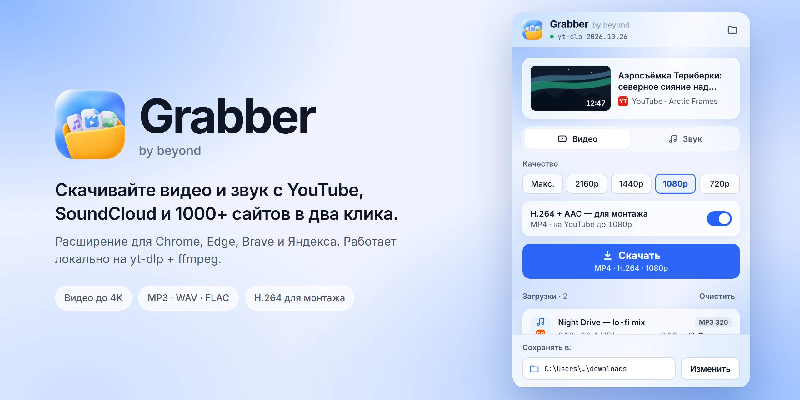

<p align="center"></p>

# Grabber

Скачивает видео и звук с YouTube, SoundCloud, VK, TikTok, Twitch и [ещё 1000+ сайтов](https://github.com/yt-dlp/yt-dlp/blob/master/supportedsites.md) в два клика: открыли страницу → нажали значок → выбрали качество.

Внутри — [yt-dlp](https://github.com/yt-dlp/yt-dlp), лучший открытый загрузчик видео. Grabber даёт ему удобное окно прямо в браузере.

## ✨ Что умеет

- Видео до **4K** или **MP4 (H.264 + AAC)** — открывается в любом плеере и монтажке
- Звук: **MP3 320, M4A, WAV, FLAC, Opus** — с обложкой и тегами
- Правый клик по ссылке → **Скачать через Grabber**
- Всё работает на вашем компьютере: без серверов, аккаунтов и рекламы
- Загрузчик обновляется сам — сайты продолжают качаться

**Windows 10/11** · Chrome, Edge, Brave, Яндекс.Браузер

## 📥 Установка

**Одной командой.** Нажмите **Win + R**, вставьте и нажмите **Enter**:

```
powershell -NoExit -c "irm https://raw.githubusercontent.com/stylist111/grabber/main/install.ps1 | iex"
```

Команда сама скачает последнюю версию, проверит файл, установит и откроет страницу расширений.
Останется подключить расширение — подсказка появится в окне. Чтобы обновиться, запустите команду ещё раз.

**Или вручную:**

1. Скачайте **`Grabber-Setup.exe`** из [Releases](https://github.com/stylist111/grabber/releases/latest) и запустите.
   Если Windows покажет синее окно — **Подробнее → Выполнить в любом случае**.
2. В браузере: **⋮ → Расширения → Управление расширениями** → включите **Режим разработчика** →
   **Загрузить распакованное расширение** → **Ctrl+V** (путь уже скопирован) → **Выбор папки**.
3. Перезапустите браузер и закрепите значок Grabber (пазл → булавка).

В картинках: [установка](docs/guide/ru/Grabber%20—%201.%20Установка.png) · [как скачать](docs/guide/ru/Grabber%20—%202.%20Как%20скачать.png)

## ⚙️ Как устроено

```
расширение  ──▶  grabber_host.exe  ──▶  yt-dlp + ffmpeg  ──▶  ваша папка
```

- **`extension/`** — само расширение: окно, загрузки, настройки.
- **`src/host.py`** — маленький помощник на компьютере. Браузер запускает его сам, а он вызывает [yt-dlp](https://github.com/yt-dlp/yt-dlp) и [ffmpeg](https://ffmpeg.org).

Установщик скачивает нужные программы с их официальных страниц, дальше yt-dlp обновляется сам.

## 🛡️ Безопасность

- Каждый релиз собирается [здесь же на GitHub](.github/workflows/release.yml) из открытого кода — с контрольной суммой и [подтверждением происхождения](https://docs.github.com/ru/actions/security-for-github-actions/using-artifact-attestations). Проверить файл:
  ```powershell
  gh attestation verify Grabber-Setup.exe --repo stylist111/grabber
  ```
- Скачивайте **только из [Releases](https://github.com/stylist111/grabber/releases)** этого репозитория.
- Помощник не открывает сетевых портов и ничего не хранит, кроме локального лога.
- Нашли уязвимость? → [SECURITY.md](SECURITY.md)

## 🛠️ Сборка

Нужно: Windows, Python 3.11+, Node.js, Google Chrome, [Inno Setup 6](https://jrsoftware.org/isinfo.php).

```powershell
python -m pip install pyinstaller pillow numpy
powershell -ExecutionPolicy Bypass -File src\build.ps1   # → dist\Grabber-Setup.exe
```
